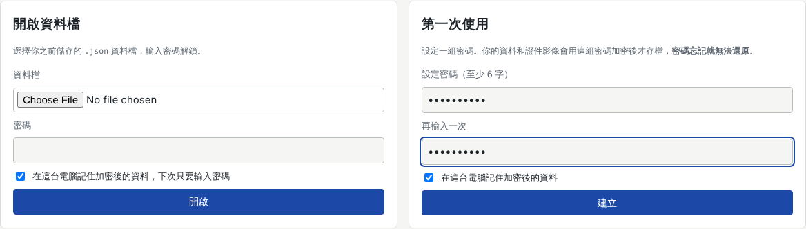
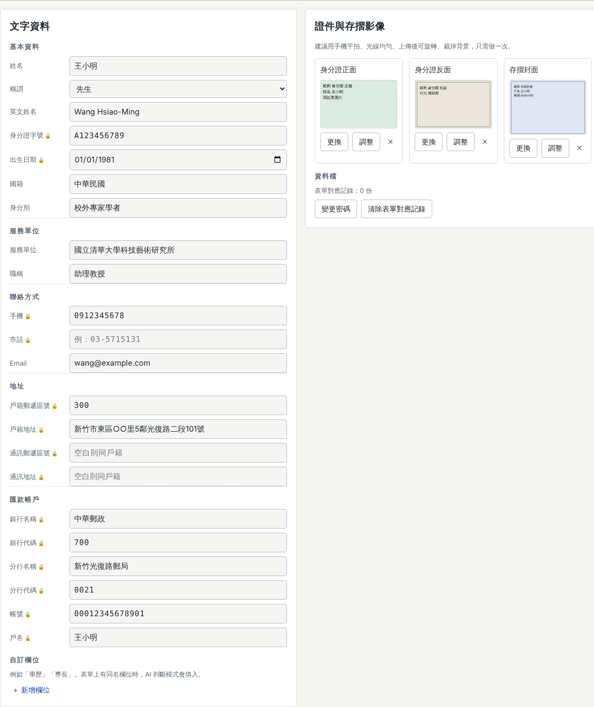
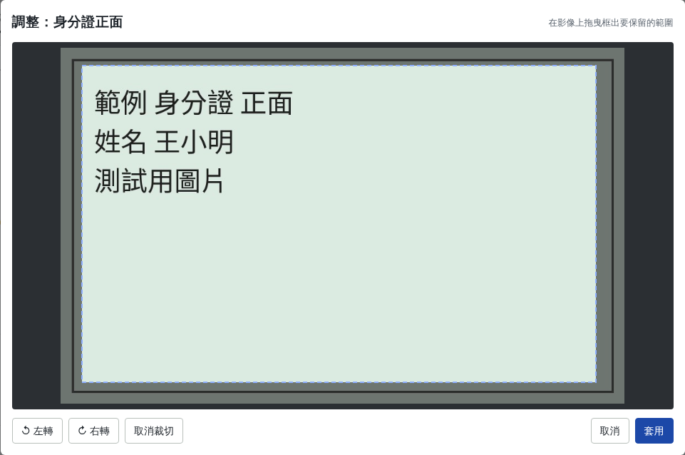
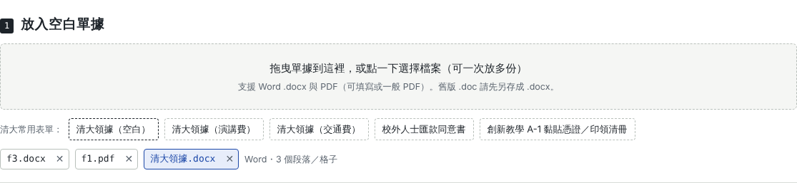
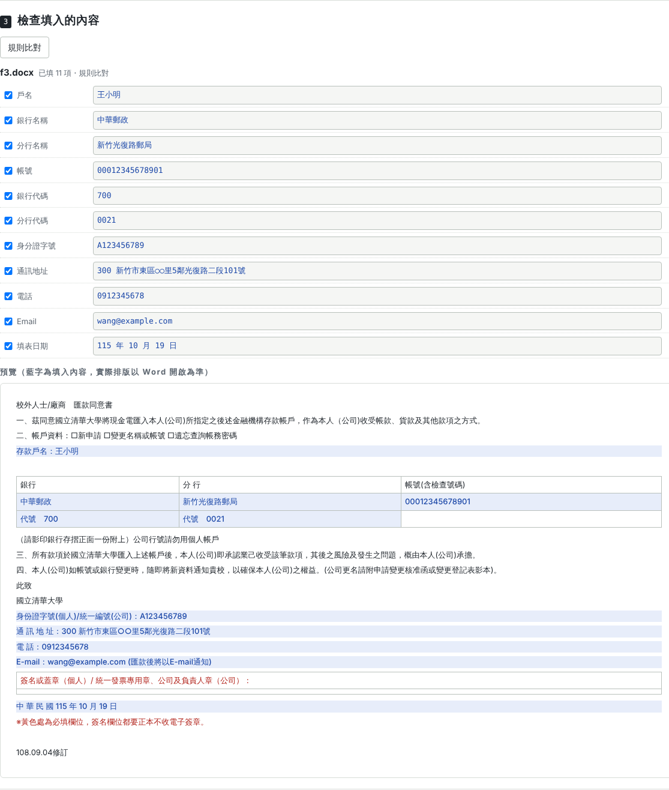
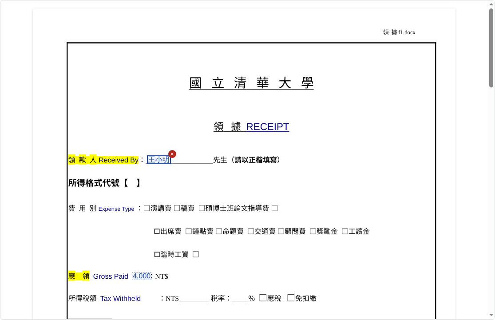
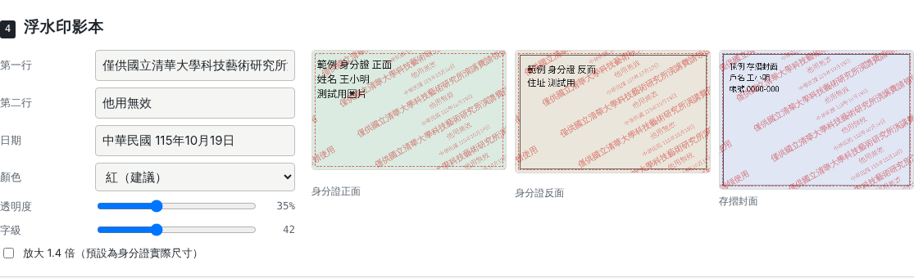
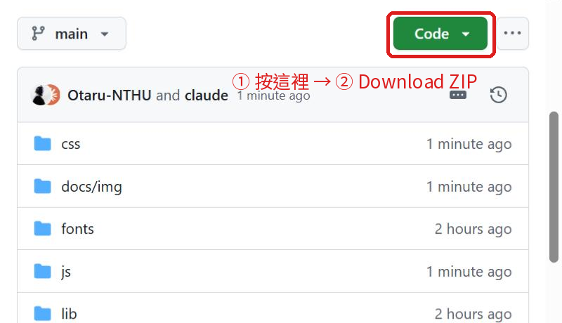
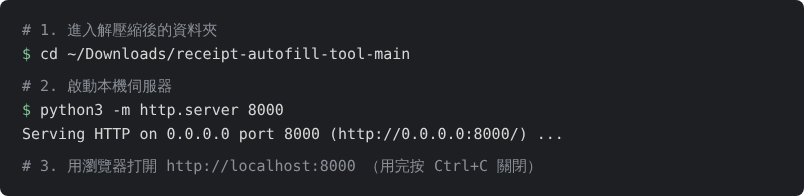

# 講座單據一次填 receipt-autofill-tool

受邀演講、審查、出席時要填的「領據、匯款同意書、印領清冊」，一次完成：

- **存好自己的資料**：姓名、身分證字號、出生日期、電話、地址、銀行與帳號，以及身分證正反面與存摺封面影像，全部加密存成一個檔案。
- **丟入空白單據就自動填好**：支援 Word `.docx`、可填寫 PDF、一般 PDF，可以一次放多份。
- **產生浮水印影本**：身分證正反面與存摺排成一頁 A4 PDF，浮水印自動帶入「僅供〇〇單位演講費請領使用・他用無效・日期」。
- **內建國立清華大學常用表單**：領據、校外人士匯款同意書、教師創新教學 A-1 黏貼憑證／印領清冊。

簽名、蓋章，以及所得稅、二代健保、實領金額、主辦單位核章等欄位一律留白。

👉 **線上使用：<https://otaru-nthu.github.io/receipt-autofill-tool/>**

---

## 目錄

- [隱私與安全](#隱私與安全)
- [一、直接使用（線上版）](#一直接使用線上版)
  - [第一次使用：建立資料檔](#第一次使用建立資料檔)
  - [每次收到單據](#每次收到單據)
- [二、自行安裝](#二自行安裝)
  - [方法 A：單一檔案，雙擊即用（推薦）](#方法-a單一檔案雙擊即用推薦)
  - [方法 B：下載原始碼＋本機伺服器](#方法-b下載原始碼本機伺服器)
- [清大表單使用提醒](#清大表單使用提醒)
- [限制](#限制)
- [開發者說明](#開發者說明)

---

## 隱私與安全

- 填寫、浮水印、加密都在**你的瀏覽器裡**完成，不會上傳到任何伺服器。網頁載入後可以斷網使用。
- 資料檔是加密的 `.json`（PBKDF2-SHA256 310,000 次＋AES-GCM-256）。檔案外流也無法讀取；**密碼忘記就無法還原**。
- 每個人用的都是自己的資料檔，不會看到別人的資料。

---

## 一、直接使用（線上版）

打開 <https://otaru-nthu.github.io/receipt-autofill-tool/>。建議使用電腦版 Chrome 或 Edge。

### 第一次使用：建立資料檔

**1. 設定密碼。**在右邊「第一次使用」輸入兩次密碼，按「建立」。勾選「在這台電腦記住」，下次打開只要輸入密碼。



**2. 填寫「我的資料」。**左欄填文字資料，右欄上傳證件影像。

- 戶籍地址請寫到「里、鄰」（清大領據有要求）。
- 出生日期只要選一次，工具會依表單需要自動轉成民國或西元。
- 通訊地址與戶籍相同可留空。
- 標 🔒 的欄位是敏感資料。



**3. 上傳並調整證件影像。**按「上傳」選擇照片後，會出現調整視窗：

- 照片歪了按「左轉／右轉」。
- **在影像上拖曳**框出證件範圍，把背景裁掉，再按「套用」。
- iPhone 的 HEIC 照片請先轉成 JPG，或用截圖代替。



**4. 儲存資料檔。**按右上角「儲存資料檔」，會存成 `我的單據資料.json`。建議放在雲端硬碟，換電腦時在首頁按「開啟資料檔」選它、輸入密碼即可。出現黃色「● 尚未存成檔案」時代表有變更還沒存。


### 每次收到單據

切到「填單」頁，從上往下做。

**1. 放入空白單據。**把 `.docx` 或 PDF 拖進虛線框，可以一次放多份。或者直接點「清大常用表單」裡的範本。上方會列出已放入的單據，點檔名可以切換，按 ✕ 移除。



**2. 填這次的活動。**「邀請單位」和「用途」會自動組成浮水印文字。金額、日期等在表單上有欄位時才需要填。國字金額與民國日期會自動換算。


**3. 檢查填入的內容。**清單列出每一個填入的欄位：

- 內容可以直接修改。
- 不想填的取消勾選。
- 顯示「沒有對應資料」代表「我的資料」少填了那一項。
- 下方預覽中的藍字是填入的內容。



**4.（PDF 才需要）調整位置。**

- 藍字位置不對就直接**拖曳**。點一下藍字會出現紅色 ✕ 可以刪除，也可以用方向鍵微調，按住 Shift 一次移 5 點。
- 有欄位沒被找到時，用「新增文字到頁面」選擇資料，按「點頁面放置」，再到頁面上點一下要放的位置。

調整過的位置會記在資料檔裡，下次放入同一份單據會直接套用。




**5. 確認浮水印。**可以調整文字、顏色、透明度與字級。



**6. 下載。**「全部打包下載（ZIP）」會把所有已填好的單據與浮水印影本放在同一個 ZIP。列印後在簽名處**親筆簽名**即可寄出。


> 在 claude.ai 開啟本工具時會多一個「用 AI 判斷欄位」按鈕，適合排版特別的單據。AI 只會收到空白表單的版面文字與欄位名稱，你的身分證、帳號、地址等內容不會送出。

---

## 二、自行安裝

想在自己電腦上離線使用、不依賴這個網址時，有兩種方式。

### 方法 A：單一檔案，雙擊即用（推薦）

不需要安裝任何軟體。

1. 下載離線版檔案（約 11 MB），有兩種方式：
   - 直接點：**[下載 receipt-autofill-offline.html](https://github.com/Otaru-NTHU/receipt-autofill-tool/raw/main/receipt-autofill-offline.html)**
   - 或在線上版頁面最下方點「下載離線版（單一檔案）」：

   

2. 把檔案放在你想放的資料夾，例如「文件」。
3. **雙擊**檔案，就會用瀏覽器打開，功能和線上版完全相同。之後的操作請看[一、直接使用](#一直接使用線上版)。

小提醒：

- 建議用 Chrome 或 Edge 開啟。如果雙擊後是用其他瀏覽器打開，可以在檔案上按右鍵 →「開啟檔案」→ 選 Chrome。
- 「在這台電腦記住」的資料是跟著瀏覽器存的。換電腦時，請用「開啟資料檔」載入你的 `.json`。
- 要更新版本，重新下載這個檔案覆蓋舊檔即可。資料檔不受影響。

### 方法 B：下載原始碼＋本機伺服器

適合想修改程式的人。需要電腦上有 Python 3：macOS 與 Linux 通常已內建，Windows 請到 [python.org](https://www.python.org/downloads/) 安裝，安裝時勾選「Add Python to PATH」。

1. 下載原始碼。可以直接點 **[下載 ZIP](https://github.com/Otaru-NTHU/receipt-autofill-tool/archive/refs/heads/main.zip)**，或在 GitHub 頁面按綠色「Code」→「Download ZIP」：

   

2. 解壓縮，會得到 `receipt-autofill-tool-main` 資料夾。
3. 開啟終端機：macOS 用「終端機」，Windows 用「命令提示字元」或 PowerShell。進入資料夾後啟動本機伺服器：

   

   ```bash
   cd ~/Downloads/receipt-autofill-tool-main      # Windows：cd %USERPROFILE%\Downloads\receipt-autofill-tool-main
   python3 -m http.server 8000                     # Windows 可改用：py -m http.server 8000
   ```

4. 用瀏覽器打開 <http://localhost:8000>。
5. 用完回到終端機按 `Ctrl + C` 關閉伺服器。

> 為什麼不能直接雙擊 `index.html`？因為瀏覽器不允許本機網頁讀取資料夾裡的字型與 PDF 元件。方法 A 的單一檔案已經把它們都包在裡面，所以可以直接雙擊。

---

## 清大表單使用提醒

- 學校網站上的表單多為舊版 `.doc`，瀏覽器無法讀取。可以直接用工具內建的「清大常用表單」，或用 Word 開啟後「另存新檔」成 `.docx`。
- 內建範本是由學校 `.doc` 轉成 `.docx`，版面可能有細微差異。正式送件前請預覽確認，若學校表單有改版，請以學校最新版本為準。
- 領據的「戶籍地址」請寫到**區、鄰、里**；外籍、港澳、大陸人士所需的證件請依表單備註另行附上。
- 印領清冊的地址分格樣板會整格換成完整地址。

## 限制

- 舊版 `.doc` 需先另存成 `.docx` 或 PDF。
- 掃描成圖片的 PDF 沒有文字可辨識，需用「新增文字到頁面」手動放置（同一份表單只需做一次）。
- PDF 疊印字型為 Noto Sans TC 的 Big5 子集，罕用字可能無法顯示。
- 費用別、身分別等勾選框不會自動勾選，請自行勾選。

## 開發者說明

```
index.html            主頁面
css/app.css           樣式
js/docx-engine.js     Word 解析與填寫
js/mapper.js          欄位字典與規則比對（docx / PDF）
js/pdf-fill.js        PDF 解析（pdf.js）、表格線偵測、輸出（pdf-lib）
js/vault.js           資料檔加解密（WebCrypto）
js/watermark.js       浮水印與 A4 影本
js/app.js             介面
templates/            內建清大表單（nthu.json 為 base64 打包）
tools/build-single.py 產生單一檔案版本
```

修改後重新產生離線版：

```bash
python3 tools/build-single.py offline receipt-autofill-offline.html
```

## 使用的開源元件

[pdf.js](https://github.com/mozilla/pdf.js)（Apache-2.0）、[pdf-lib](https://github.com/Hopding/pdf-lib) 與 @pdf-lib/fontkit（MIT）、[JSZip](https://github.com/Stuk/jszip)（MIT／GPLv3 雙授權，此處依 MIT）、[Noto Sans TC](https://fonts.google.com/noto/specimen/Noto+Sans+TC)（OFL-1.1）。

浮水印樣式延續 [護照影本浮水印工具](https://otaru-nthu.github.io/passport-watermark-tool/)。

本工具以 MIT 授權釋出。
